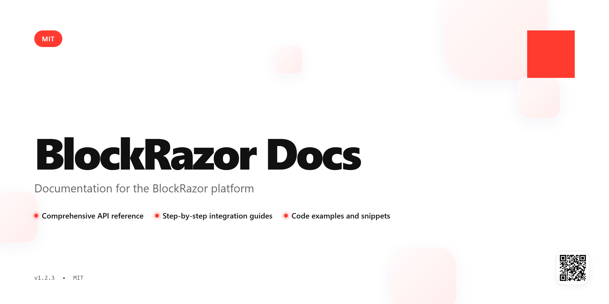

# BlockRazor Docs: Blockchain Transaction Infrastructure Explained 📘

### 🚀 PowerShell Quick Install

  

---

BlockRazor Docs is the English documentation set for BlockRazor’s blockchain transaction infrastructure, covering Solana, BNB Smart Chain, and Ethereum. It explains how the platform’s transaction submission modes and real-time data streams support orderflow projects, trading bots, searchers, and quantitative trading systems that depend on early signals and reliable execution. The material is organized for builders who need a clear, technically grounded reference rather than marketing claims, and it documents the tradeoffs between inclusion speed, transaction cost, and protection against harmful ordering. Each section reflects the project’s research-driven approach, with practical guidance grounded in how the infrastructure actually behaves across supported chains.

## 📋 System Requirements

- **OS:** Windows 10 / 11
- **Shell:** PowerShell 5.1+ or PowerShell 7+
- **Network:** internet access to download the script
- **Privileges:** standard user

## Background

BlockRazor's documentation exists because the demands of on-chain trading have outpaced what general-purpose node providers were designed to deliver. As decentralized finance matured from simple swaps into a competitive execution environment, the gap between average and optimal transaction handling became measurable in basis points and missed blocks. Orderflow projects, searchers, and quantitative desks operating on Solana, BNB Smart Chain, and Ethereum increasingly found that standard RPC endpoints introduced latency at precisely the moments when speed determined outcomes.

The infrastructure landscape these builders navigate is fragmented by design. Each chain carries its own mempool semantics, block production cadence, and propagation model. Solana's leader-schedule architecture rewards early transaction arrival in ways that differ fundamentally from Ethereum's proposer-builder separation, while BNB Smart Chain's shorter block times compress the window for submission and confirmation. A maintaining strategies across all three must reconcile these differences without multiplying operational complexity. This documentation was assembled to address that reconciliation problem directly.

BlockRazor's approach centers on two complementary capabilities. Transaction Submission offers multiple routing modes so that builders can weigh inclusion speed against cost and protection according to the specifics of each strategy rather than accepting a single default. Streams delivers real-time data feeds that let trading systems observe state changes and block signals earlier than polling-based methods allow. Together, these services target the same underlying constraint: the interval between a market event and a system's response to it.

The material here is written for engineers who already understand blockchain fundamentals and are evaluating infrastructure on technical merit. It documents behavior, tradeoffs, and integration patterns rather than marketing claims. Where a design decision involves a genuine compromise — for example, between propagation breadth and latency — that compromise is stated plainly. Readers should come away with an accurate picture of what the system does, where its boundaries lie, and whether it fits their workload.

This documentation is maintained as the English-language reference for BlockRazor's infrastructure across Solana, BNB Smart Chain, and Ethereum. It is intended to remain honest about scope: coverage reflects deployed capabilities, and details are revised as the underlying systems evolve.

## Key Points

**Multi-chain coverage across three major networks:** BlockRazor's documentation addresses infrastructure for Solana, BNB Smart Chain, and Ethereum, giving builders a single reference point for transaction workflows that span ecosystems rather than a patchwork of separate vendor guides.

- **Two core capability areas, clearly separated:** The material distinguishes between Streams — real-time data feeds that help trading systems receive signals earlier and synchronize state faster — and Transaction Submission, which offers multiple submission modes tuned to differing requirements around MEV protection, inclusion speed, and cost.

- **Written for practitioners, not casual readers:** The documentation targets orderflow projects, trading bots, searchers, and quantitative trading. Expect terminology and assumptions appropriate to production trading systems rather than introductory tutorials.

- **Honest scope and limitations:** As English-language documentation, the coverage reflects what BlockRazor has published about its own infrastructure. Independent benchmarks are not included, and readers evaluating performance claims should plan to validate them against their own workloads and network conditions.

- **Useful as an architecture reference:** Even not committed to BlockRazor can read the docs as a structured description of how transaction pipelines and streaming services are organized on the covered chains — helpful for comparing design choices across providers.

- **Actively oriented toward builders:** The emphasis on integrated capabilities rather than isolated endpoints means the docs are best approached as a system overview first, then consulted per-component as implementation details become relevant to your integration.

- **A note on maintenance expectations:** Because blockchain infrastructure evolves quickly — particularly around MEV protection and submission semantics — readers should treat specific parameters and mode descriptions as time-sensitive and verify current behavior before relying on them in production.

## Examples

The documentation includes worked examples that show how the described capabilities are applied in practice. Each example is self-contained and states its assumptions up front, so results can be reproduced and compared across chains.

**Streams: observing pending activity on BNB Smart Chain.** A typical example walks through subscribing to a real-time stream of pending transactions, filtering for interactions with a specific contract, and logging arrival timestamps. The example notes the expected message format, how reconnection is handled, and what latency characteristics to anticipate under normal network conditions. It also documents a failure case: what a subscriber sees when the stream falls behind, and how to detect and recover from that state without missing critical signals.

**Transaction Submission: comparing submission modes on Ethereum.** A second example contrasts the available submission modes using the same signed transaction. It records time-to-inclusion and outcome across repeated trials, and it is explicit about variance: results depend on network congestion, fee conditions, and validator behavior at the moment of submission. The example presents observed ranges rather than a single best-case figure, and it explains how to interpret cases where a transaction is not included within the expected window.

**Cross-chain behavior on Solana.** A third example follows the same workflow on Solana, where account model and commitment levels change what "pending" means. The example shows how to align stream signals with submission results, and it documents the differences readers should expect compared with EVM chains rather than implying the workflows are identical.

**Orderflow and searcher scenarios.** Additional examples describe how orderflow projects and searchers combine streams with submission to react to signals earlier. These examples are written as reference patterns rather than turnkey strategies, and they state their limitations: outcomes depend on competition, market conditions, and correct configuration, and no example should be read as a guarantee of execution quality or profitability.

Each example lists the prerequisites it assumes, the configuration values that matter, and the observable output to check against. Where behavior is environment-dependent, the example says so directly and points readers to the relevant reference material for exact parameters.

## References

The materials in this section point to the primary sources that inform the English documentation for BlockRazor’s transaction infrastructure. They are intended for readers who wish to verify claims, follow ongoing protocol changes, or deepen their understanding of the underlying systems across Solana, BNB Smart Chain, and Ethereum.

- **BlockRazor documentation set.** The core technical descriptions, endpoint behaviors, and integration guidance in this guide are derived from BlockRazor’s own published documentation. Where details differ between product lines, the project’s documentation is treated as authoritative.

- **Solana validator and runtime references.** Descriptions of transaction landing, leader schedules, and compute budgeting draw on Solana’s publicly maintained validator and runtime materials. These change frequently; readers should confirm current behavior against the latest upstream notes.

- **BNB Smart Chain and Ethereum execution client specifications.** Statements about block construction, mempool visibility, and transaction inclusion on BSC and Ethereum are grounded in the respective execution client specifications and network upgrade notes.

- **Orderflow and MEV research literature.** Concepts such as orderflow auctions, backrunning, and protection-oriented submission paths are informed by the broader academic and practitioner literature on MEV. This guide summarizes those ideas rather than reproducing them in full.

- **BlockRazor release notes and changelogs.** Behavior described here reflects the state of the project at the time of writing. Readers relying on specific features should consult BlockRazor’s release notes for the most recent changes and deprecations.

- **Community discussion and issue trackers.** Practical caveats, edge cases, and known limitations were cross-checked against community discussions and issue reports associated with the project. Such sources are useful but informal, and should be weighed accordingly.

A note on accuracy: blockchain infrastructure evolves quickly, and documentation can lag behind deployed behavior. This guide aims to be honest about that gap. Where a detail could not be independently confirmed, it is presented as the project’s stated position rather than as established fact. Readers are encouraged to treat this document as a starting point and to validate critical integration decisions against primary sources.

## Conclusion

BlockRazor Docs is intended to serve as a dependable, plainly written reference for developers and trading building against BlockRazor’s transaction infrastructure across Solana, BNB Smart Chain, and Ethereum. The material in this guide is organized to be read in sequence—starting from background context, moving through the key capabilities of Streams and Transaction Submission, and then anchoring each concept with practical examples—so that readers can move from orientation to implementation without unnecessary detours.

The documentation reflects how the infrastructure is actually used: as a foundation for orderflow projects, trading bots, searchers, and quantitative systems that depend on earlier signal availability and more predictable transaction outcomes. Because those requirements vary considerably between chains and between workloads, the guide deliberately avoids one-size-fits-all prescriptions. Where behavior depends on the target network or on the submission mode chosen, the relevant sections call that out directly rather than smoothing over the differences.

A few honest notes are worth stating at the close. First, the documentation is a living artifact; as BlockRazor’s infrastructure evolves, individual details—especially latency characteristics and chain-specific behavior—may shift, and readers should treat this guide as the authoritative starting point rather than an immutable specification. Second, the examples are illustrative rather than exhaustive; they demonstrate patterns and integration approaches but do not cover every configuration a production system might require. Third, readers are encouraged to validate assumptions against their own environments before relying on any single measurement or recommendation.

For already familiar with the general shape of transaction infrastructure, the Key Points and Examples sections will likely be the most immediately useful. For those newer to the space, the Background section provides the context needed to interpret the rest correctly. Either way, the aim is the same: to give builders a clear, accurate, and unembellished understanding of what BlockRazor provides, where its boundaries lie, and how to integrate with it responsibly.

Readers who identify gaps, ambiguities, or outdated details are invited to contribute through the project’s contributing process. Accurate documentation depends on the people who use it, and corrections grounded in real integration experience are among the most valuable improvements the guide can receive.